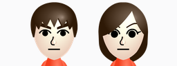
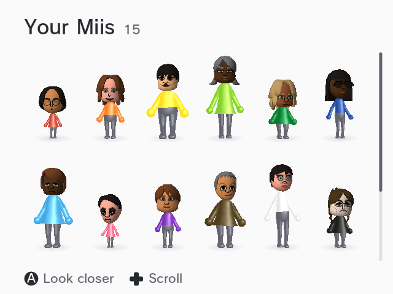
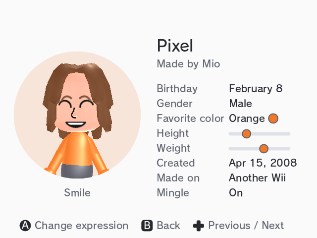

# 

MiiKit Demo is a Wii app that shows every Mii on your Wii in 3D, with their faces and bodies read straight from the system. It's a demo of [MiiKit](https://github.com/cmyksoda/MiiKit), the Mii library that started as sdk/mii in [hbc-reborn](https://github.com/Monsterray/hbc-reborn).





## Controls

| | Wii Remote | GameCube controller |
|---|---|---|
| Choose a Mii | Point, or D-pad | D-pad |
| Look closer | A | A |
| Scroll | D-pad up / down | D-pad up / down |
| Change expression | A | A |
| Previous / Next Mii | D-pad left / right | D-pad left / right |
| Back | B | B |
| Quit | HOME | Start |

The console's RESET button also quits, and POWER turns the Wii off.

## Installing

Copy the `apps/sdk-mii-demo/` folder from the release zip to the root of your SD card, then open it from the Homebrew Channel.

Opened from the Homebrew Channel, the demo can read the Mii faces from your Wii. If it's opened some other way, it uses a copy of `RFL_Res.dat` in `sd:/mii` instead, which hbc-reborn's "Save Mii faces" makes.

## Building

MiiKit Demo builds with devkitPPC and devkitPro's libogc, plus Python 3 with Pillow and fontTools for its font and cursor generators. The font file isn't in this repository: point `FONT` at your copy of FOT-RodinNTLG Pro DB.

```
make FONT=/path/to/FOT_RodinNTLG_Pro_DB.otf    # sdk-mii-demo.dol
```

`make TOUR=1` builds a version for testing in Dolphin, which plays a scripted visit and saves screenshots to `sd:/tour`. `tools/` holds the scripts that check its frames and music, and `test_db.c`, which makes a database of random Miis to test with.

## Credits

- **MiiKit** (sdk/mii in hbc-reborn), by the hbc-reborn developers, with its NAND loader by cmyksoda
- **"Focus Loop"** by FreeGroove, from Pixabay, under the Pixabay Content License
- **The pointing hand**, from drmr's Wii Homebrew Cursors, under the LGPL 3.0 ([licenses/](licenses/))
- The interface font, FOT-RodinNTLG Pro DB, © 2003 Fontworks Japan, Inc. RodinNTLGPro is a trademark of Fontworks Japan, Inc.
- **The icon**, Nintendo's artwork of the default Miis
- **libogc**, **libmad**, **libasnd**, and **devkitPPC**, from devkitPro and their authors

The Miis' faces and bodies belong to Nintendo. They're read from your Wii each time the demo starts, and none of them are in this repository.

## License

The demo's code is under the GNU General Public License, version 3 or later ([LICENSE](LICENSE)). MiiKit, in `source/mii`, is public domain. The music, cursor, font and icon are under their own terms, above.

---

*This project was made with AI assistance. For more information, see [my AI usage statement](https://github.com/cmyksoda/cmyksoda/blob/main/AI_USAGE.md).*
